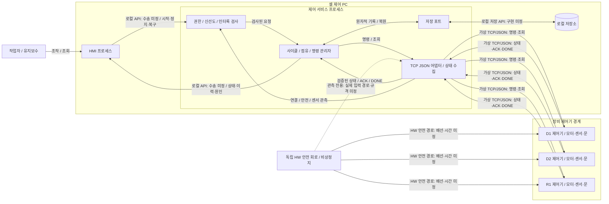

# 자동화 셀 아키텍처 초안

## 1. 범위와 근거
- **확인된 입력:** [requirements.md](requirements.md) v1, REQ-01~16. 신규 SW이며 기존 코드베이스는 없다.
- **설계 제안:** 아래 컴포넌트 분리, 단일 배정 실행자, 저장 선행 규칙과 복구 절차. 요구사항 충족을 위한 초안이며 구현 검증 결과가 아니다.
- **미정:** 실제 프로토콜·주소·레지스터·제어 주기·안전 정지 시간, 장비별 DONE 제한시간, 저장 보존 기간, OS·프레임워크·DB.
- 가상 TCP/JSON 시험만 대상으로 한다. 실제 제어·현장 배포·안전 인증 및 Word/Excel/Figma 양식 검증은 범위 밖이다. 센서/제어기가 물리 상태의 원본이다. (REQ-02,16)

## 2. 시스템 경계와 배치
다음은 계획된 시스템의 실제 구성요소와 통신 방향을 나타내는 Mermaid 소스다. 점선은 안전 상태 관측 경로이며 안전 제어 명령 경로가 아니다. (REQ-14)

| 실행 위치 / 계층 | 책임과 의존 경계 |
|---|---|
| PC / 표시 계층 HMI | 상태·연결·센서·단계·알람·요청/ACK/DONE을 텍스트와 색으로 표시. 장비에 직접 명령하지 않음. |
| PC / 제어 계층 G, O | G가 인증된 역할과 최신 관측을 검사. O가 사이클·자원 점유·불명 결과를 관리하며 명령 발행을 독점. |
| PC / 어댑터 계층 A | 장비별 독립 연결, 메시지 검증·정렬·heartbeat, 도메인 이벤트 변환. 저수준 모터/경로 제어 제외. |
| PC / 저장 계층 P, S | 설정, cycle/command, 점유 복원 자료, 알람·감사 기록. HMI는 직접 저장소를 변경하지 않음. |
| D1/D2/R1 제어기 | 실제 실행·상태·센서 원본, command_id 중복 억제와 결과 조회. 가상 시험에서 이 능력을 모델링해야 함. |
| 독립 안전 HW | 비상정지·안전 동작 담당. PC의 중지/알람 처리는 안전 동작의 성공 증거가 아님. |

**실행 제안:** HMI와 제어 서비스는 별도 프로세스, O는 한 개의 직렬 배정 실행자다. 어댑터 I/O는 비동기 수집 후 O의 이벤트 큐로 전달한다. 프로세스 간 경쟁을 피하려고 제어 서비스의 중복 인스턴스는 시작을 거부한다. 하나의 PC 장애 시 배정은 멈추며 자동 대기계 전환은 이번 범위 밖이다.
**배치 구분:** 가상 시험에서는 제어기 시뮬레이터가 장비 경계를 대신한다(실행 호스트 미정). 실장비 배치는 그림의 장비별 제어기로 분리하되 실제 안전 관측 경로와 네트워크 구성은 공급사 확인 후 결정한다.

## 3. 인터페이스와 불변식
- **HMI→G:** 시작·일시정지(작업자), 복구 확정(유지보수). 서비스가 역할을 다시 검사한다. 일시정지는 신규 배정 차단이며 진행 중 작업의 물리 정지 명령이 아니다. 인증 수단은 미정. (REQ-08~10)
- **O→A→제어기:** 변경 명령은 command_id, cycle_id, target, type 포함. ACK는 수신만, DONE은 물리 완료. 동일 ID 재수신은 이전 결과 반환이며 다른 물리 작업을 만들지 않는다. 같은 ID에 다른 내용은 오류로 거부하도록 제안한다. (REQ-04)
- **제어기→A:** schema_version, sender, sequence 및 측정값의 단위·측정 시각·유효성 포함. 발신자별 마지막 수용 순번 이하 상태는 폐기하고 폐기 이유를 기록한다. 제어기 재시작의 순번 초기화는 세션/부트 식별 계약을 추가하는 제안이며 합의 전에는 대조 완료까지 배정을 차단한다. (REQ-12)
- **상태 모델:** D1/D2=IDLE/PROCESSING/READY/FAULT/OFFLINE, R1=IDLE/BUSY/FAULT/OFFLINE. OFFLINE은 연결 투영이며 마지막 물리 관측을 정상 상태로 갱신하지 않는다. O의 RESULT_UNKNOWN/RECOVERY_REQUIRED는 장비 상태와 별개다. (REQ-02,06)
- **시간:** heartbeat 1초, 마지막 수신 후 3초면 OFFLINE, ACK 대기 2초. 시간차 판정에는 단조 시계를 제안한다. 개별 센서 유효 기간은 미정이며 유효성·신선도를 증명할 수 없으면 시작/이송 차단. DONE 제한시간 미정은 임의 완료 판정의 근거가 아니다. (REQ-05,10)
- **점유:** O가 D1 출구·R1·D2 입구를 하나의 이송 점유로 먼저 확보한다. DONE과 제어기·공작물 위치 대조 전에는 해제하거나 새 이송을 배정하지 않는다. 서로 모순된 센서는 불명 상태로 유지한다. (REQ-03,16)
- **저장/송신:** 유일 command_id, cycle 변경, 점유, 요청 감사 이벤트를 한 트랜잭션으로 확정한 뒤 송신한다. 기록 실패 시 송신 금지. 기록 후 송신 전/후 중단은 송신 여부를 추정하지 않고 재시작 대조 대상으로 처리한다. (REQ-11)
- **응답 저장 실패:** ACK/DONE 기록 실패 시 신규 배정과 점유 해제를 막고 복구 필요를 표시한다. 메모리상의 DONE만으로 다음 단계로 진행하지 않는다. 알람 삭제는 물리 복구나 점유 해제를 유발하지 않는다. (REQ-11,13)

## 4. 주요 실행 시나리오
**S1 정상 사이클 (REQ-01,03~05,10~12)**
1. 작업자가 시작 → G가 역할·최신 연결/안전/문 상태를 검사 → O가 cycle과 D1 가공 명령을 원자 기록 후 송신한다. ACK만으로 다음 단계로 가지 않는다.
2. D1 DONE과 READY·공작물 있음을 확인한다. G/O가 D2 IDLE·비어 있음, R1 IDLE, 관련 문 닫힘, 안전 정상과 관측 신선도를 다시 검사한다.
3. 이송 점유와 R1 명령을 함께 기록한 뒤 송신한다. ACK는 요청 수락 표시만 갱신한다. R1 DONE 및 D1 비어 있음·D2 공작물 있음 등 제어기 관측을 대조해 이송 완료를 기록한다.
4. 점유 해제와 다음 단계 전이를 기록한다. D2 가공 전 조건을 재검사하고 명령 기록→송신→ACK→DONE을 거쳐 cycle 완료를 기록한다. 위치가 맞지 않으면 완료 대신 복구 필요다.

**S2 이송 중 두절 또는 ACK 유실 (REQ-03,05,06,10)**
1. A가 heartbeat 3초 미수신 또는 O가 ACK 2초 초과를 검출하면, O는 실행 여부를 알 수 없는 명령을 RESULT_UNKNOWN으로 전환한다.
2. 점유 유지, 셀 신규 배정 차단, HMI에 마지막 관측 시각·불명 명령·차단 원인을 표시한다. 이동 명령 자동 재전송 금지. SW는 로봇의 실제 정지를 주장하지 않는다.
3. 늦은 ACK/DONE은 동일 cycle/command로 연계해 대조 자료로 기록한다. 그것만으로 자동 재개하지 않는다. 문 열림/비상정지 관측도 신규 명령을 차단하며 실제 정지는 HW 책임이다.

**S3 재접속·앱 재기동·권한별 복구 (REQ-07,09,11,13)**
1. 서비스 기동/재접속은 RECOVERY_REQUIRED로 시작한다. 저장된 cycle/command/점유를 불러오고 제어기의 해당 명령 결과·최신 상태·센서를 조회한다. 정상 연결만으로 배정을 풀지 않는다.
2. 완료 증거·위치가 일치하면 완료 후보, 미완료/미실행 증거가 명확하면 중단/재계획 후보로 제시한다. 결과·위치가 모순되거나 조회 불가이면 현장 확인이 필요하며 점유를 유지한다.
3. 유지보수만 원인 해소·대조 근거·선택한 후속 단계로 복구를 확정한다. 서비스는 역할과 최신 안전 조건을 재검사하고 감사 기록을 원자 저장한다. 작업자의 복구 요청은 거부한다.
4. 복구 확정은 배정 가능한 상태로의 전이이며 자동 시작이 아니다. 작업자의 별도 시작 후 다음 단계만 실행한다. 기존 불명 이동을 다시 발행하지 않으며 새 명령이 필요한 경우 현장 확인된 재계획과 새 ID를 사용한다.

## 5. 결정과 미정
| ID / 구분 | 선택·근거·영향 또는 해결 조건 |
|---|---|
| D-01 제안 | 단일 배정 실행자와 명령 전 원자 저장: 병렬 배정 경쟁과 무기록 송신을 줄임. 처리량 한계는 추후 측정. |
| D-02 입력 준수 | 불명 결과에서 자동 재전송/재개 금지: 처리량보다 중복 물리 작업 방지가 우선. 유지보수 개입 필요. |
| D-03 제안 | 제어/어댑터/저장을 포트로 분리: 가상 TCP/JSON과 실제 규격을 교체 가능하게 함. 구체 프레임워크는 보류. |
| O-01 미정 | 공급사가 중복 억제·명령 결과 보존·재기동 식별 계약을 확인해야 함. 보장 불가 시 자동 복구 불가. |
| O-02 미정 | DONE 시간·센서 신선도·안전 관측 배선/시간은 장비·안전 담당 확인 필요. 현재 수치를 발명하지 않음. |
| O-03 미정 | 저장 엔진/보존 기간/백업, 인증·접근 제어 방식은 운영 요구로 결정. 전원 중단 원자성은 시험 필요. |

## 6. 추적과 품질 시나리오 — 다음 검증의 기준
아래는 계획이며 실행 합격을 뜻하지 않는다. 가상 시험은 SW 계약만 확인하고 물리 동작·안전 성능은 별도 HIL/실장비 검증이 필요하다. (REQ-15)

| 요구사항 | 설계 위치 | 입력 → 기대 결과 / 관측 방법 |
|---|---|---|
| REQ-01, REQ-02, REQ-03 | §2~4 S1 | 정상 cycle → D1/R1/D2 순서, 이송 조건과 선점 충족 / 명령 타임라인·점유 기록 |
| REQ-04 | §3, S1 | 동일 명령 2회 주입 → 물리 실행 1회, 같은 결과 / 시뮬레이터 실행 카운터·응답 |
| REQ-05, REQ-06 | S2 | 이송 중 끊김·ACK 유실 각각 → 3초 OFFLINE/2초 불명, 신규 이동 0건 / 가상 시계·송신 로그 |
| REQ-07 | S3 | 송신 전후 앱 중단·재접속 → 자동 송신 0건, 대조 대기 / 저장 스냅샷·송신 로그 |
| REQ-08, REQ-09 | §2~3, S3 | 작업자 복구 요청 → 거부·감사, HMI 상태와 ACK/DONE 구별 / API 응답·화면 |
| REQ-10 | §3, S2 | 문 열림·비상정지·오래된 상태에서 시작/이송 → 서비스 송신 0건·원인 표시 / API 우회 요청·로그 |
| REQ-11 | §3 | 요청/응답 저장 실패·저장 도중 중단 → 부분 명령 기록 0건, 신규 배정 차단 / 복원 데이터·송신 로그 |
| REQ-12 | §3 | 순번 12 후 11 도착 → 12 유지, 무효 측정 사용 금지 / 수용·폐기 기록 |
| REQ-13 | S3 | 알람만 삭제 → 복구 필요·점유 유지 / 상태 전이·센서 대조 자료 |
| REQ-14, REQ-15, REQ-16 | §1~6 | 경계/미정/추적 문서 검토 및 위 시나리오 수행 계획 / 도표·판정 근거 확인 |

## 7. 원본 기여·라이선스·한계
Gernot Starke·Peter Hruschka의 [arc42-template](https://github.com/arc42/arc42-template/tree/32fd461c91b184777e14f7d66b4e46db936fd3e5), 고정 commit `32fd461c91b184777e14f7d66b4e46db936fd3e5`의 03/05/06/07/09/10장을 읽었다. 출처·원본 바이트 해시는 후보의 SOURCE.json에 있다.
원본과 템플릿 각색 부분은 [CC BY-SA 4.0](https://creativecommons.org/licenses/by-sa/4.0/), [원본 라이선스](../../upstream/LICENSE.txt)를 따른다. 변경 범위는 해당 장의 관점을 한국어로 축약하고 구성도·책임표·실행 시나리오·결정표·품질 시나리오로 재구성한 것이다. 원저자의 승인·보증을 뜻하지 않는다. 독립 작성한 프로젝트 설계 내용과 원본 템플릿의 라이선스는 구분한다.
arc42는 경계·정적 분해·배치·동적 시나리오·결정 이유를 빠뜨리지 않게 도왔다. 소스코드 이해라는 building block 동기를 신규 설계 분해로 각색했으며 코드 분석 결과는 없다. 원본은 장비 명령 중복 억제·저장 원자성·안전 규격을 제공하지 않으므로 위 설계는 요구사항에서 도출한 제안이다.
