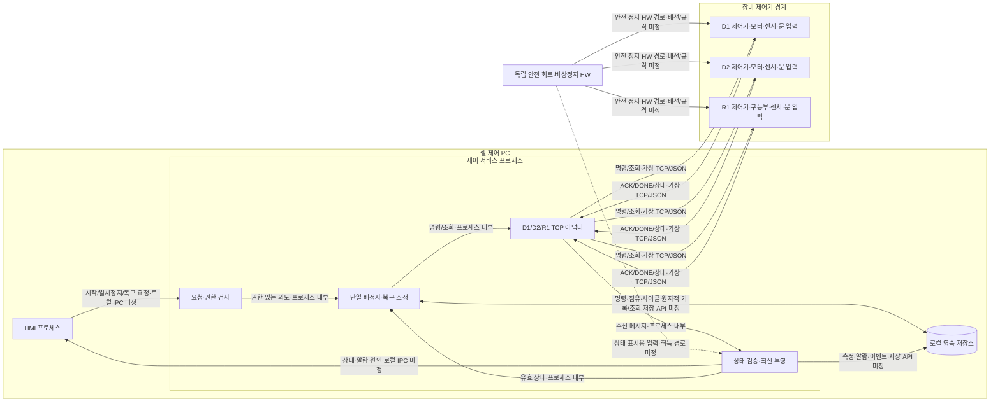

# D1·D2·R1 셀 아키텍처 제안

작성: 2026-10-14 · 입력: requirements.md v1 · 신규 프로젝트 · 구현/장비 검증 전

## 1. 근거와 적용 범위

- **확인된 입력**: PC가 D1·D2·R1에 작업을 배정한다. 실제 상태는 각 제어기가 소유하며 안전 정지는 독립 HW가 담당한다. REQ-01~16을 기준으로 한다.
- **설계 제안**: 아래 프로세스 분리, 단일 배정자, 저장 트랜잭션, 인터페이스 이름과 복구 단계는 구현 방향이며 현재 구현이 아니다.
- **미정**: 실제 프로토콜/주소/레지스터, 제어 주기, 안전 정지 시간, DONE 제한시간, 기술 스택, DB, 신원 확인 방식, 보존 기간.
- 원본 `architecture-blueprint-generator`는 코드·설정·의존성에서 실제 아키텍처를 추출한다. 코드베이스가 없어 기술 자동 탐지, 실제 의존성/배치 검증, 구현 코드 예시와 기존 결정의 역사 분석은 수행할 수 없다.
- 원본의 계층/경계, 데이터, 횡단 관심사, 배치, 시험, 결정 기록 구조를 신규 설계 제안에 적용했다. 원본만으로 장비의 중복 억제나 안전 성능은 보장되지 않는다.
- 결과는 Markdown 설계안이다. Word/Excel/Figma 양식 적합성, 실장비 제어, 안전 인증 및 현장 배포는 범위 밖이다. [REQ-16]

## 2. 실제 대상 시스템 구성도 — 제안 배치

아래는 대상 PC·장비·안전 HW의 구체적 경계를 표현한 Mermaid 소스다. 실측 배선이나 존재하는 구현을 뜻하지 않는다. 화살표는 논리 정보/명령 방향이다. [REQ-14]

안전 상태 취득은 논리 경로만 표시했다. 제어기 중계인지 별도 IO인지 확정하지 않는다. PC는 안전 정지를 집행하는 구성요소가 아니다.

## 3. 계층, 책임과 실행 구조

| 컴포넌트 | 책임 및 소유 데이터 | 경계/실행 제안 | 요구 |
|---|---|---|---|
| HMI | 장비 상태·연결·센서·단계·알람·요청/ACK/DONE과 차단 원인 표시 | 별도 프로세스, 색상과 텍스트 병기; 장비/DB 직접 접근 금지 | REQ-08, REQ-10 |
| 요청·권한 검사 | 사용자 의도를 검증하고 역할 확인 | 서비스가 시작/이송 조건과 복구 권한 재검사; 클라이언트 역할 주장 신뢰 금지 | REQ-09, REQ-10 |
| 배정자·복구 조정 | cycle 단계, command 수명, R1 및 D1/D2 이송 점유 | 서비스 내 단일 직렬 이벤트 처리; 자동 재개 금지 | REQ-01, REQ-03, REQ-06, REQ-07 |
| 상태 검증·투영 | 원본 상태와 연결/최신성/품질을 분리 유지 | 장비별 순번 검증 후 투영; 센서를 단계 추정으로 덮어쓰지 않음 | REQ-02, REQ-12, REQ-16 |
| 장비 어댑터 | 연결·heartbeat·ACK 대기·메시지 검증·조회 | 장비별 비동기 IO, 수신을 직렬 배정자에 전달; 재연결은 조회만 허용 | REQ-04, REQ-05, REQ-06 |
| 저장소 포트 | 설정, cycle/command, 점유, 알람/감사 영속화 | 트랜잭션과 command_id 유일 제약 요구; DB 제품 미정 | REQ-11 |
| 장비/안전 HW | 실제 상태, 저수준 제어, 경로 계획 / 독립 안전 동작 | SW는 관찰·배정만 수행; 장비 측 명령 중복 억제 필요 | REQ-02, REQ-04, REQ-14 |

의존성 제안은 HMI → 서비스 요청 포트 → 도메인 정책 → 저장/장비 추상 포트다. 외부 어댑터가 포트를 구현한다. 도메인은 UI·TCP·DB 구현을 참조하지 않는다.
프로세스 시작 시 서비스는 RECOVERY_REQUIRED로 부팅한다. 저장소 읽기/무결성 확인 실패도 시작 차단 사유다. HMI 종료·재실행으로 서비스의 점유가 해제되지 않는다.
단일 활성 서비스만 장비 연결/배정을 소유하도록 로컬 독점 실행을 제안한다. 다중 PC 고가용성과 네트워크 리더 선출은 이번 범위에 넣지 않는다.
HMI 단절 시 신규 배정 중지는 제안 정책이며, 진행 중 물리 작업의 중단을 의미하지 않는다. 재접속 후 상태를 조회한다.

## 4. 인터페이스와 데이터 경계

가상 TCP/JSON은 입력에서 정한 시험 계약이다. 프레이밍, 오류 코드, 인증, 재접속 백오프와 실제 장비 매핑은 미정이며 네트워크 운영 규격으로 사용하지 않는다.
변경 명령은 `command_id`, `cycle_id`, `target`, `type`을 필수로 한다. ACK는 수신만 의미하고 단계 진행/점유 해제 근거가 아니다. DONE은 해당 command와 target을 대조해야 한다. [REQ-04]
제어기는 동일 command_id를 중복 수신하면 재실행 없이 이전 결과를 반환한다. 재기동을 넘는 중복 억제 보존 범위와 결과 조회 지원은 장비 계약 확인 항목이다. 미지원이면 자동 복구를 허용하지 않는다.
메시지 공통의 schema_version·sender·sequence와 측정의 단위·측정 시각·validity를 검사한다. 지원하지 않는 버전/발신자/손상 메시지는 격리하고 유효 heartbeat로 계산하지 않는다. [REQ-12]
순번은 발신자별로 비교하여 중복·역순이 최신 상태를 덮어쓰지 못하게 한다. 재연결 시 세션 세대 식별을 추가하는 제안이며 실제 지원은 미정이다. 새 세대의 전체 상태 대조 전 이전/새 스트림을 섞지 않는다.
heartbeat 1초, 유효 수신 후 3초 경과 OFFLINE, ACK 대기 2초는 가상 시험 상수다. 경과시간은 단조 시계로 판정한다. 센서별 freshness 한계는 미정이며 정하기 전 시작을 허용하지 않는다. [REQ-05, REQ-10]
장비 원본 상태는 D1/D2의 IDLE·PROCESSING·READY·FAULT·OFFLINE, R1의 IDLE·BUSY·FAULT·OFFLINE을 유지한다. 내부 UNKNOWN/RECOVERY_REQUIRED는 명령·사이클 관리 상태이며 장비 상태를 대체하지 않는다.
Cycle은 Commands를 가지며 Command가 target과 점유를 참조한다. 결과 미상 명령/점유는 재기동 시 복구 대상이다. 최신 투영은 재구축 가능하되 영속 명령 이력과 원본 조회를 대신하지 않는다.
발신 전에 command_id·cycle 변경·점유·발신 의도를 한 트랜잭션으로 저장한다. commit 실패 시 전송하지 않는다. 전송과 DB commit은 하나의 원자적 작업이 아니므로 전송 여부 불확실 구간은 결과 미상으로 남긴다. [REQ-11]
발신 후 기록 실패나 DONE 저장 실패 시 새 배정을 차단한다. 기록을 복구하고 장비 결과를 대조하기 전 메모리상 성공만으로 다음 단계를 진행하지 않는다. 저장 복귀 후 감사 기록을 보충하며 손실 가능 구간을 명시한다.
감사 이벤트는 행위자·역할·대상 command/cycle·사유·시각·결과를 연결한다. 설정 변경은 버전과 검증 결과를 기록하며 진행 중 사이클에 소급 적용하지 않는 정책을 제안한다.

## 5. 정상·장애·복구 시나리오

1. **정상**: 작업자 시작 → 서비스 권한/최신성/안전 조건 확인 → D1 가공 의도 저장·발신 → ACK 표시 → DONE과 D1 READY/공작물 확인 → 이송 전 조건 재검사 → 점유 저장 → R1 발신 → ACK → DONE 및 공작물 대조 → 점유 해제 기록 → D2 가공 → DONE 확인·완료 저장. [REQ-01, REQ-03, REQ-04]
2. **이송 직전**: D1 READY·공작물 있음, D2 IDLE·비어 있음, R1 IDLE, 관련 문 닫힘, 안전 정상, 모두 최신이어야 한다. 배정자 직렬 구간에서 검사·예약한다. 예약 후 조건 변화 감지 시 미발신 명령을 취소한다. 검사와 실제 운동 사이 안전은 독립 HW/장비 인터록 책임이다. [REQ-03, REQ-10]
3. **이송 중 끊김/ACK 유실**: 3초 유효 수신 없음 또는 2초 ACK 없음 → command 결과 미상 → 점유 유지·신규 배정 차단·원인 표시. 물리 이동이 계속됐을 가능성을 보존하고 자동 이동 재전송을 하지 않는다. 뒤늦은 ACK/DONE도 곧바로 자동 재개를 유발하지 않는다. [REQ-05, REQ-06]
4. **재접속/앱 재기동**: 저장된 command/cycle/점유 읽기 → 제어기 현재 상태·기존 command 결과 조회 → 센서와 물리 공작물 위치 대조 → 불명확하면 현장 확인 → 유지보수 역할로 해결 근거 확정 → 원자적 복구 기록 → 별도 시작 요청으로만 다음 작업. [REQ-07, REQ-09]
5. **문 열림/비상정지/알람 삭제**: 안전 HW가 독립 동작하고 SW는 새 시작/이송을 차단한다. 일시정지도 신규 배정만 막는다. 알람 확인/삭제는 물리 정상의 증거가 아니며 원인 해소·최신 상태 대조·필요한 복구 확정을 거친다. [REQ-09, REQ-10, REQ-13]

복구 결과는 미실행 확인, 완료 확인, 불명 유지로 구분한다. 완료가 확인되면 기존 명령 결과를 정합화하고 새 이동을 보내지 않는다. 미실행 확인도 즉시 재전송하지 않고 승인된 후속 작업을 별도 식별자로 만든다. 불명 상태에서는 점유를 유지한다.
역할 없는 복구 요청은 서비스에서 거부·감사한다. 점유 해제에는 단순 R1 IDLE 외에 기존 명령의 종결 근거와 D1/D2 공작물 대조가 필요하다. DONE 제한시간은 미정이므로 임의 시간 경과로 성공/실패를 단정하지 않는다.

## 6. 설계 결정과 변경 지점

| 결정 | 이유·대안 | 영향/미정 |
|---|---|---|
| 단일 배정자 + 비동기 IO | 여러 독립 배정 서비스보다 점유·단계 경합을 한곳에서 통제 | 서비스 중단 시 가용성 감소; 재기동 대조 필수 |
| UI와 제어 정책 분리 | 버튼 비활성화만으로 권한/인터록을 보장할 수 없음 | 로컬 IPC·인증 구현 미정; UI 교체가 장비 규칙에 영향 없게 함 |
| 전송 전 원자적 의도 기록 | 전송 후 기록만 하면 정전 시 명령 추적 상실 | DB/네트워크 간 exactly-once 주장 불가; 불확실 구간은 조회·복구 |
| 자동 이동 재시도 금지 | ACK 유실과 미실행을 구별할 수 없음 | 복구 인력 필요; 조회 능력/중복 기록 보존은 장비 계약 승인 조건 |

새 장비는 포트 구현과 상태 매핑, 중복/재기동 계약 시험을 추가한다. 도메인 순서를 바꾸면 점유 및 복구 규칙을 함께 재검토한다. 설정/스키마 변경은 저장 자료 이행과 구버전 거부 시험을 포함한다.
기술 스택·컨테이너·클라우드는 선택하지 않았다. 원본의 기술별 구현 패턴/코드 예시는 입력 근거가 없어 생략했다. 향후 실제 코드가 생기면 경계 위반·배치 설정과 이 문서를 대조하여 갱신한다.

## 7. 요구 추적과 시험 경계

아래는 **향후 행동 시험 계획**이다. 현재 실행한 것은 별도 test-log.md의 문서 정합성 검사뿐이며 장비/시뮬레이터 시험 통과가 아니다. [REQ-15]

| 시험 ID | 입력/자극 | 기대 결과 및 관측 | 요구 |
|---|---|---|---|
| T01 | 가상 정상 상태에서 시작·각 DONE 제공 | 명령 이력 순서 D1→R1→D2; ACK만으로 단계 진행 없음 | REQ-01, REQ-02, REQ-04, REQ-08 |
| T02 | 이송 중 R1 유효 수신을 3초 중단 | OFFLINE/결과 미상 표시; 점유 유지; 후속 발신 0건 | REQ-03, REQ-05, REQ-06 |
| T03 | 이동은 수신했으나 ACK 2초 유실 | 결과 미상; 재전송 0건; 조회·복구 대기 기록 | REQ-04, REQ-05, REQ-06 |
| T04 | 동일 command_id를 장비 시험 더블에 두 번 전달 | 물리 동작 카운터 1; 이전 결과 반환. 실장비 보장 별도 확인 | REQ-04 |
| T05 | sequence 12 뒤 11 상태·무효 측정 전달 | 투영 12 유지; 무효 측정 표시·진단 기록; 원본 센서 추정 금지 | REQ-12, REQ-16 |
| T06 | 전송 직전/직후 앱 종료 후 재기동·재접속 | 자동 명령 0건; 저장 이력·제어기 대조; 유지보수 확정 뒤 별도 시작 | REQ-07, REQ-11 |
| T07 | 문 열림·안전 비정상·오래된 상태·일시정지 | 서비스 직접 호출도 신규 시작/이송 거부; 원인 표시; 알람 삭제로 해제 안 됨 | REQ-09, REQ-10, REQ-13 |
| T08 | 작업자 역할로 복구 확정 API 호출 | 거부·감사 기록; 점유 유지; 유지보수 경로만 허용 | REQ-09 |
| T09 | 의도 commit 실패 및 DONE 저장 실패 주입 | 전자는 발신 0건, 후자는 후속 배정 0건; 부분 명령 저장 없음 | REQ-11 |
| T10 | 구성도/입력 추적 문서 검사 | PC/장비/안전 경계·방향·미정 확인; 실제 배선은 별도 검증 | REQ-14, REQ-16 |

도메인 단위 시험은 가상 시계·저장 실패 더블, 통합 시험은 가상 TCP 제어기와 저장 중단, HIL/실장비 시험은 센서 대조·중복 억제·안전 HW 연계를 다룬다. 마지막 단계는 이번에 실행하지 않았다.
미정 해소 책임: 장비 담당자는 결과 조회/중복 보존·실제 통신, 안전 담당자는 안전 배선/인터록, SW 담당자는 freshness·저장·인증 정책, 운영 담당자는 보존/현장 복구 절차를 확정해야 한다. 이들은 제안 역할이며 실제 담당자는 지정되지 않았다.
