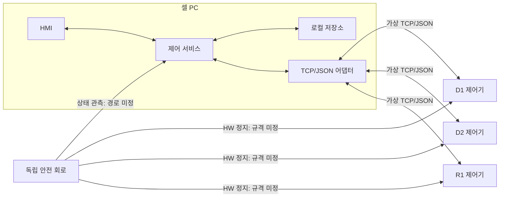

# 인터페이스 설계 초안 — 가상 셀 v1

## 1. 범위와 근거
- [입력] D1 가공 → R1 이송 → D2 가공 순서다. REQ-01.
- [입력] 제어기가 물리 상태의 원본이며 PC는 작업을 배정한다. REQ-02,16.
- [제안] 아래 JSON은 비교용 계약이며 실제 장비 프로토콜이 아니다.
- [미정] 실제 주소, 포트, 레지스터, 제어 주기, 안전 정지 시간, 인증 방식.
- [미정] 장비별 DONE 제한 시간, 저장 보존 기간, 컨트롤러 영속 중복 방지 지원.
- Fprime 도입을 결정하지 않는다. Word/Excel/Figma 양식과 실장비 검증은 범위 밖이다.

## 2. 경계와 포트
| 출발 → 도착 | 제안 인터페이스 | 책임 |
|---|---|---|
| HMI → 제어 서비스 | 로컬 요청 API | 시작·일시정지·유지보수 복구 |
| 제어 서비스 → HMI | 상태/알람 구독 | 요청·ACK·DONE·원인 텍스트 |
| 제어 서비스 ↔ 저장소 | 트랜잭션 API | 명령·사이클·점유·감사 원자 저장 |
| 제어 서비스 ↔ 어댑터 | send/received/returned/txStatus | 프레임 수명과 전송 상태 |
| 어댑터 ↔ D1/D2/R1 | 가상 TCP/JSON | 명령·조회·ACK·DONE·상태 |
| 독립 안전 회로 → 제어기/PC | HW 정지/상태 관측; 실제 배선 미정 | 정지는 HW, SW는 억제·표시 |


REQ-14: 도식의 화살표는 논리 흐름이며 실제 배선 확정이 아니다.

## 3. 프레이밍과 공통 봉투
- [제안] UTF-8 JSON 한 개에 LF 한 개, 최대 65536바이트(종결 LF 제외).
- TCP 분할/병합은 누적 파서가 처리하며 문자열 개행은 JSON escape만 허용한다.
- 초과 길이·잘못된 UTF-8·JSON·필수 필드 누락은 폐기/알람, 명령 실행 금지.
- 공통 필수: schema_version=1, sender, boot_id, seq, kind, sent_at, payload.
- sender는 PC/D1/D2/R1 열거형, boot_id는 UUID 문자열, seq는 0 이상 안전 정수다.
- sent_at은 UTC RFC3339; 신선도는 PC의 단조 수신 시각으로 판단한다.
- 상태 순번은 sender+boot_id별 증가한다. seq 이하의 상태는 저장 이력만 남기고 적용하지 않는다.
- 새 boot_id는 재기동 후보로 격리하고 조회 대조 전 제어 가능한 연결로 인정하지 않는다.
- 상태와 이벤트 순서를 분리한다. DONE은 상태 high-water mark로 버리지 않고 command_id별 처리한다.
- 지원하지 않는 버전/알 수 없는 변경 명령 type은 명시적 거절한다. REQ-12.

## 4. 메시지 계약
| kind | payload 필수 항목 | 의미 |
|---|---|---|
| COMMAND | command_id, cycle_id, target, type, args | 변경 요청 |
| ACK | command_id, cycle_id, target, accepted, reason | 수신·검증 결과; 완료 아님 |
| DONE | command_id, cycle_id, target, outcome, evidence | 컨트롤러의 실제 작업 완료/실패 보고 |
| QUERY | query_id, target, command_id 또는 snapshot=true | 읽기 전용 대조 |
| QUERY_RESULT | query_id, boot_id, command_result, snapshot | UNKNOWN도 유효 결과 |
| STATE | state, sensors, safety_ok, measurements | 제어기 원본 상태 |
| HEARTBEAT | health | 생존 신호; 센서 신선도를 갱신하지 않음 |

```json
{"schema_version":1,"sender":"PC","boot_id":"00000000-0000-4000-8000-000000000001","seq":7,"kind":"COMMAND","sent_at":"2026-10-14T00:00:00Z","payload":{"command_id":"00000000-0000-4000-8000-000000000007","cycle_id":"00000000-0000-4000-8000-000000000002","target":"R1","type":"TRANSFER","args":{"from":"D1","to":"D2"}}}
```
- command_id/cycle_id는 UUID 형식, target은 D1/D2/R1; PROCESS는 D1/D2, TRANSFER는 R1만 허용한다.
- ID는 저장소 유일 제약으로 충돌을 거절한다. 재시작해도 새 요청에 이전 ID를 재사용하지 않는다.
- 동일 command_id+동일 정규화 payload는 저장한 결과를 반환하고 실행 횟수는 증가하지 않는다.
- 동일 ID의 다른 payload는 ID_CONFLICT로 거절한다. 컨트롤러에서도 원자적 등록이 필요하다.
- 중복 방지 기록 유실/보존 만료는 UNKNOWN이다. 미해결 ID는 자동 재실행하지 않는다.
- STATE: D1/D2=IDLE/PROCESSING/READY/FAULT, R1=IDLE/BUSY/FAULT.
- OFFLINE은 PC 연결 관측값이며 마지막 컨트롤러 상태를 별도 보존한다. REQ-02.
- sensors는 workpiece_present, door_closed와 각 관측 유효성을 포함한다.
- measurements는 name, value(유한 수), unit, measured_at, valid를 갖는다.
- 유효하지 않거나 누락된 센서는 false와 구별되는 UNKNOWN으로 처리한다.

## 5. 소유권과 응답 수명
- 송신 프레임은 enqueue 시 어댑터 소유, 성공/실패 후 returned로 정확히 한 번 반환한다.
- returned 이후 txStatus를 한 번 발생시켜 다음 전송 가능 여부를 알린다.
- 수신 프레임은 파서에 빌려주고 복사/검증 종료 후 반환한다. 반환 전 재사용 금지.
- txStatus=SUCCESS는 바이트 전송 처리 결과일 뿐 ACK나 DONE이 아니다.
- [제안] 대상별 송신 1개 진행, 대기열 32개 상한; 초과는 명시적 BACKPRESSURE.
- 재접속의 ready는 조회 전송만 허용한다. 변경 명령 큐 자동 배출/재전송 금지.
- 셀 자원 점유는 버퍼 소유권과 별개다. 이송 전에 D1/D2/R1을 cycle_id에 원자 점유한다.
- 점유는 timeout/연결 해제/알람 삭제로 해제되지 않는다. REQ-03,06,13.

## 6. 시간과 장애 시퀀스
- heartbeat=1초, 마지막 유효 heartbeat 이후 >=3초면 OFFLINE; 가상 시험 값이다.
- STATE도 제안 기준 >=3초면 stale; heartbeat 수신만으로 stale을 풀지 않는다.
- 명령 송신 시작부터 ACK >=2초 미수신이면 UNKNOWN+HOLD. DONE 제한 시간은 미정이다.
- PROCESS/TRANSFER ACK accepted=true는 ACKED로만 이동한다. accepted=false면 REJECTED.
- 정상: 저장/점유 → COMMAND → ACK → DONE → 신선한 상태 대조 → 다음 단계.
- ACK 유실: UNKNOWN 유지 → QUERY → 명령 결과/센서 대조 → 유지보수 승인.
- 이송 중 단절: 점유 유지 → 신규 배정 억제 → 재접속 → QUERY → 현장 확인 → 승인.
- DONE 선도착: 일치 ID/대상 결과를 기록하고 완료 대조; 늦은 ACK는 완료 상태를 되돌리지 않는다.
- 불명 상태의 늦은 DONE은 증거로 보존하되 HOLD를 자동 해제하지 않는다.
- 상충하는 DONE/센서는 RECOVERY_REQUIRED; 물리 위치를 추측해서 정정하지 않는다.
- 안전 입력 비정상/문 열림은 신규 명령 차단과 알람; 실제 정지는 독립 HW 책임이다.

## 7. 추적·출처·미검증
- REQ-01~07: 계약/순서/점유/timeout/복구; REQ-08~10: HMI 이벤트/권한/서버 억제.
- REQ-11~13: 원자 저장/순번/알람; REQ-14~16: 경계/검사/가정 구분.
- 원본 communication-adapter-interface.md와 Com.fpp: 방향·반환·전송 준비의 명시적 계약 구조를 적용.
- 원본 Svc/Health/docs/sdd.md: 요구→포트→기능→시나리오→검사 연결 구조를 적용.
- 원본의 실패 데이터 재전송과 복구 시 큐 재개는 REQ-06/07 때문에 적용하지 않는다.
- 원본 Health는 SW ping 감시다. 장비 heartbeat나 안전 회로의 검증 근거로 전용하지 않는다.
- 이 계약은 설계 제안이며 구현/네트워크/장비 상호운용성 검증은 수행하지 않았다.
